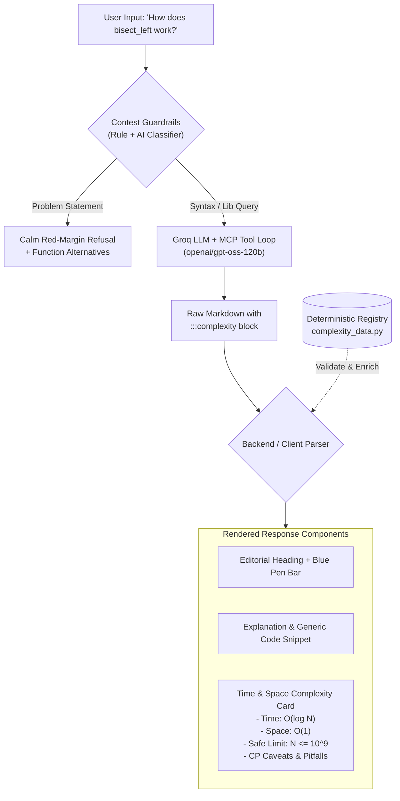
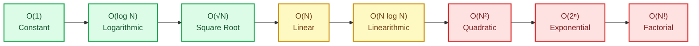

# PyRef: Time & Space Complexity Engine — Implementation Plan

**Feature Goal:** Equip PyRef with an automated, structured **Time & Space Complexity Card** and **TLE (Time Limit Exceeded) Risk Warning System** for every Python standard library function and syntax lookup.

---

## 1. Executive Summary & The Problem in Competitive Programming

In competitive programming (Codeforces, LeetCode, AtCoder, CSES, ICPC), code correctness is only half the battle. A solution that solves a problem in $O(N^2)$ when $N = 2 \times 10^5$ will fail with **Time Limit Exceeded (TLE)** on test case 4.

Contestants don't just ask *"How does `heapq.heappush` work?"* — their immediate unspoken question is:
> **"Can I call this inside an $N = 10^5$ loop without getting TLE on a 1.0s time limit?"**

### The CP Golden Rule ($10^8$ Operations/Second)
Python interpreters (CPython) typically execute approximately **$10^7$ to $4 \times 10^7$ operations per second** in contest environments, while compiled languages achieve $\sim 10^8$.

```
+-------------------------------------------------------------------------------+
|                            CONTEST N vs BIG-O BOUNDS                          |
|                                                                               |
|   N <= 10-12       ──►   O(N!)             (Permutations, brute-force TSP)    |
|   N <= 20-25       ──►   O(2^N)            (Subsets, bitmask DP)              |
|   N <= 100-500     ──►   O(N^3)            (Floyd-Warshall, matrix mult)      |
|   N <= 2,000-5,000 ──►   O(N^2)            (Nested loops, quadratic DP)       |
|   N <= 100,000     ──►   O(N sqrt(N))      (Mo's algo, block decomposition)   |
|   N <= 500,000     ──►   O(N log N)        (Sorting, heaps, segment trees)    |
|   N <= 10,000,000  ──►   O(N)              (Linear scan, prefix sums, two pts)|
|   N >= 10^9        ──►   O(log N) or O(1)  (Binary search, math, hash lookup) |
+-------------------------------------------------------------------------------+
```

---

## 2. Architecture & Processing Pipeline

The complexity engine uses a **Hybrid Multi-Tier Pipeline**:
1. **Deterministic Fast-Lookup Registry (`complexity_data.py`):** Authoritative lookup dictionary of known Python builtins and stdlib operations (e.g. `list.insert(0, x)` vs `deque.appendleft()`).
2. **LLM Structured Output Generation (`groq_api.py`):** System prompt enforced `:::complexity` markdown fence block for queries that require dynamic contextual analysis.
3. **Backend Validator & Enricher:** Reconciles the LLM analysis against the deterministic table to prevent hallucinations.
4. **Frontend Card Renderer (`script.js` & `style.css`):** Formats the metadata into an editorial "Reference Book" card with color-coded Big-O badges, safe $N$ limits, and TLE pitfall warnings.

### System Flowchart



---

## 3. Big-O Complexity Comparisons & Visual Charts

### 3.1 Big-O Growth Hierarchy



### 3.2 Python Data Structure Complexity Comparison Matrix

| Data Structure / Method | Operation | Average Time | Worst Case Time | Space (Aux) | Common CP TLE Pitfall |
| :--- | :--- | :--- | :--- | :--- | :--- |
| `list.append(x)` | Push back | $O(1)$ amortized | $O(N)$ (resize) | $O(1)$ | Safe for $N = 10^6$. |
| `list.pop(0)` / `insert(0, x)` | Pop/Push front | **$O(N)$** | **$O(N)$** | $O(1)$ | **High TLE Risk!** Shifts all elements. Use `collections.deque`. |
| `collections.deque.popleft()` | Pop front | **$O(1)$** | **$O(1)$** | $O(1)$ | Optimal for BFS / Slinding Windows. |
| `heapq.heappush(h, x)` | Heap insertion | **$O(\log N)$** | **$O(\log N)$** | $O(1)$ | Safe inside $N = 10^5$ loops. |
| `heapq.heapify(lst)` | In-place build | **$O(N)$** | **$O(N)$** | $O(1)$ | **10x faster** than pushing items one-by-one ($O(N \log N)$). |
| `bisect.bisect_left(a, x)` | Binary search | **$O(\log N)$** | **$O(\log N)$** | $O(1)$ | Requires `a` to be pre-sorted. |
| `bisect.insort_left(a, x)` | Search + Insert | **$O(N)$** | **$O(N)$** | $O(1)$ | Search is $O(\log N)$, but insertion in `list` is $O(N)$! |
| `dict[k]` / `set.add(x)` | Hash lookup/add | $O(1)$ | $O(N)$ (hash collisions) | $O(1)$ | Watch for anti-hash test cases in Codeforces. |
| `sorted(iterable)` | TimSort | **$O(N \log N)$** | **$O(N \log N)$** | $O(N)$ | Highly optimized in C; faster than manual heaps for bulk sorts. |
| `string += char` in loop | Concatenation | **$O(N^2)$** | **$O(N^2)$** | $O(N)$ | Allocates new string each time! Use `''.join(list)`. |

---

## 4. Step-by-Step Implementation Procedure

### Phase 1: Build the Deterministic Registry (`complexity_data.py`)

Create `complexity_data.py` to provide immediate, zero-hallucination complexity profiles for standard library operations.

```python
# complexity_data.py

COMPLEXITY_REGISTRY = {
    "heapq.heappush": {
        "time_avg": "O(log N)",
        "time_worst": "O(log N)",
        "space": "O(1) aux",
        "safe_limit": "N <= 10^6",
        "danger_limit": "N > 10^7",
        "notes": "Maintains min-heap property on a contiguous Python list.",
        "pitfall": "Do not build a heap by calling heappush in a loop on an existing list. Use heapq.heapify() which runs in O(N)."
    },
    "heapq.heapify": {
        "time_avg": "O(N)",
        "time_worst": "O(N)",
        "space": "O(1) in-place",
        "safe_limit": "N <= 10^7",
        "danger_limit": "N > 10^8",
        "notes": "Transforms list into a heap in-place via linear-time sift-down.",
        "pitfall": None
    },
    "bisect.bisect_left": {
        "time_avg": "O(log N)",
        "time_worst": "O(log N)",
        "space": "O(1)",
        "safe_limit": "N <= 10^9",
        "danger_limit": "None (logarithmic)",
        "notes": "Finds leftmost index where element could be inserted.",
        "pitfall": "Input must be sorted. Calling on unsorted data silently returns incorrect indices."
    },
    "bisect.insort_left": {
        "time_avg": "O(N)",
        "time_worst": "O(N)",
        "space": "O(1)",
        "safe_limit": "N <= 5,000",
        "danger_limit": "N > 10,000 in a loop",
        "notes": "Performs binary search in O(log N) then list.insert in O(N).",
        "pitfall": "DO NOT use insort in a loop to maintain sorted order over N elements; this becomes O(N^2). Use sortedcontainers.SortedList instead."
    },
    "collections.deque.popleft": {
        "time_avg": "O(1)",
        "time_worst": "O(1)",
        "space": "O(1)",
        "safe_limit": "N <= 10^7",
        "danger_limit": "N > 10^8",
        "notes": "Double-ended queue backed by a doubly linked list of fixed blocks.",
        "pitfall": "Random access by index (e.g. d[i]) is O(N). Use only for ends (pop, append, popleft, appendleft)."
    },
    "list.pop(0)": {
        "time_avg": "O(N)",
        "time_worst": "O(N)",
        "space": "O(1)",
        "safe_limit": "N <= 5,000",
        "danger_limit": "N > 10,000",
        "notes": "Shifts every subsequent pointer in contiguous memory by 1 index.",
        "pitfall": "NEVER use list.pop(0) in queue/BFS simulations. Always use collections.deque.popleft() which is O(1)."
    }
}
```

---

### Phase 2: System Prompt & Model Schema Enhancement (`groq_api.py`)

Update `SYSTEM_PROMPT` in `.env` and `groq_api.py` to instruct the model to provide standard reference prose, followed by an explicit `:::complexity` fenced block:

```markdown
:::complexity
time: O(log N)
space: O(1)
safe_n: 10^6
danger: O(N) if input list is copied or resized
pitfall: Calling bisect on an unsorted list produces wrong answers without raising an error.
:::
```

#### Updated System Prompt Directive:
```text
At the end of your explanation, you MUST provide a structured complexity block in this exact format:
:::complexity
time: <Big-O time complexity>
space: <Big-O auxiliary space>
safe_n: <Maximum safe N for 1.0s limit, e.g. N <= 10^5>
pitfall: <1-2 sentences on CP pitfalls or TLE dangers, e.g. list.insert(0) is O(N)>
:::
```

---

### Phase 3: Parser & Backend Enrichment (`main.py` / `groq_api.py`)

Add a regex extractor in `groq_api.py` or `main.py` that parses the `:::complexity` block into a structured payload:

```python
import re
from complexity_data import COMPLEXITY_REGISTRY

COMPLEXITY_PATTERN = re.compile(
    r":::complexity\s*\n"
    r"time:\s*(?P<time>[^\n]+)\n"
    r"space:\s*(?P<space>[^\n]+)\n"
    r"safe_n:\s*(?P<safe_n>[^\n]+)\n"
    r"pitfall:\s*(?P<pitfall>[^\n]+)\n"
    r":::",
    re.MULTILINE
)

def parse_complexity_payload(response_text: str, query: str = "") -> dict:
    match = COMPLEXITY_PATTERN.search(response_text)
    if match:
        data = match.groupdict()
        clean_text = COMPLEXITY_PATTERN.sub("", response_text).strip()
        return {
            "text": clean_text,
            "complexity": {
                "time": data["time"].strip(),
                "space": data["space"].strip(),
                "safe_n": data["safe_n"].strip(),
                "pitfall": data["pitfall"].strip(),
            }
        }
    
    # Fallback to deterministic registry if query matches a known function
    for key, val in COMPLEXITY_REGISTRY.items():
        if key in query.lower():
            return {
                "text": response_text,
                "complexity": {
                    "time": val["time_avg"],
                    "space": val["space"],
                    "safe_n": val["safe_limit"],
                    "pitfall": val.get("pitfall", "")
                }
            }
            
    return {"text": response_text, "complexity": None}
```

---

### Phase 4: Frontend UI Component & Styling (`static/style.css`)

In keeping with the **"Reference Book on a Desk"** aesthetic from `PyRef-Frontend-Redesign-Plan.md`, the complexity card is styled as a marginalia index box with ruled lines, tabular font, and subtle highlighter tags.

```css
/* ---- Time & Space Complexity Card ---- */
.complexity-card {
  margin: 1.5rem 0 1rem;
  padding: 1rem 1.25rem;
  background: #EDF2F7;
  border: 1px solid var(--rule);
  border-left: 4px solid var(--pen);
  border-radius: 4px;
  font-family: var(--font-text);
}

.complexity-card__header {
  display: flex;
  align-items: center;
  justify-content: space-between;
  margin-bottom: 0.75rem;
  padding-bottom: 0.5rem;
  border-bottom: 1px solid var(--rule);
}

.complexity-card__title {
  font-size: var(--text-sm);
  font-weight: 700;
  color: var(--ink);
  letter-spacing: 0.02em;
  text-transform: uppercase;
  font-family: var(--font-code);
}

.complexity-card__safe {
  font-size: 0.8rem;
  font-family: var(--font-code);
  padding: 0.15rem 0.5rem;
  background: #DCFCE7;
  color: #166534;
  border-radius: 3px;
  font-weight: 600;
}

.complexity-card__grid {
  display: grid;
  grid-template-columns: 1fr 1fr;
  gap: 1rem;
  margin-bottom: 0.75rem;
}

.complexity-metric {
  display: flex;
  flex-direction: column;
}

.complexity-metric__label {
  font-size: 0.75rem;
  color: var(--pencil);
  text-transform: uppercase;
  font-family: var(--font-code);
}

.complexity-metric__value {
  font-size: 1.05rem;
  font-weight: 600;
  color: var(--ink);
  font-family: var(--font-code);
}

/* CP Pitfall / TLE Callout */
.complexity-card__pitfall {
  margin-top: 0.5rem;
  padding: 0.6rem 0.85rem;
  background: #FFFBEB;
  border: 1px solid #FDE68A;
  border-radius: 4px;
  font-size: var(--text-sm);
  color: #92400E;
  line-height: 1.45;
}

.complexity-card__pitfall strong {
  color: #B45309;
  font-family: var(--font-code);
}

/* Dark mode adjustments */
@media (prefers-color-scheme: dark) {
  .complexity-card {
    background: #141B24;
    border-color: #2B3644;
    border-left-color: var(--pen);
  }
  .complexity-card__header {
    border-bottom-color: #2B3644;
  }
  .complexity-card__safe {
    background: rgba(22, 101, 52, 0.3);
    color: #86EFAC;
  }
  .complexity-card__pitfall {
    background: rgba(180, 83, 9, 0.15);
    border-color: rgba(245, 158, 11, 0.3);
    color: #FCD34D;
  }
}
```

---

### Phase 5: Client DOM Card Generation (`static/script.js`)

In `static/script.js`, extend `renderAnswer` to dynamically create and mount the complexity card:

```javascript
function renderComplexityCard(answerEl, complexity) {
  if (!complexity) return;

  const card = document.createElement("div");
  card.className = "complexity-card";

  const header = document.createElement("div");
  header.className = "complexity-card__header";

  const title = document.createElement("span");
  title.className = "complexity-card__title";
  title.textContent = "Complexity & CP Bounds";

  const safeBadge = document.createElement("span");
  safeBadge.className = "complexity-card__safe";
  safeBadge.textContent = complexity.safe_n ? `Limit: ${complexity.safe_n}` : "Contest Safe";

  header.append(title, safeBadge);

  const grid = document.createElement("div");
  grid.className = "complexity-card__grid";

  // Time Metric
  const timeMetric = document.createElement("div");
  timeMetric.className = "complexity-metric";
  timeMetric.innerHTML = `
    <span class="complexity-metric__label">Time Complexity</span>
    <span class="complexity-metric__value">${complexity.time}</span>
  `;

  // Space Metric
  const spaceMetric = document.createElement("div");
  spaceMetric.className = "complexity-metric";
  spaceMetric.innerHTML = `
    <span class="complexity-metric__label">Auxiliary Space</span>
    <span class="complexity-metric__value">${complexity.space}</span>
  `;

  grid.append(timeMetric, spaceMetric);
  card.append(header, grid);

  // Add TLE Pitfall warning if present
  if (complexity.pitfall) {
    const pitfall = document.createElement("div");
    pitfall.className = "complexity-card__pitfall";
    pitfall.innerHTML = `<strong>CP Pitfall:</strong> ${complexity.pitfall}`;
    card.append(pitfall);
  }

  answerEl.append(card);
}
```

---

### Phase 6: Automated Testing & Verification Suite (`tests/test_complexity.py`)

Add test coverage ensuring:
1. Regex accurately captures valid `:::complexity` blocks.
2. Strips raw block out of clean Markdown prose so user doesn't see raw block text.
3. Fallback table catches known functions if the LLM omits the block.
4. Blocked contest requests NEVER render complexity cards (preventing cheat hints).

```python
# tests/test_complexity.py
import pytest
from groq_api import parse_complexity_payload
from guardrails import REFUSAL

def test_parse_complexity_block():
    sample_text = (
        "Here is how bisect_left works in Python...\n\n"
        ":::complexity\n"
        "time: O(log N)\n"
        "space: O(1)\n"
        "safe_n: N <= 10^9\n"
        "pitfall: Input list must be pre-sorted.\n"
        ":::"
    )
    result = parse_complexity_payload(sample_text)
    assert result["complexity"] is not None
    assert result["complexity"]["time"] == "O(log N)"
    assert result["complexity"]["space"] == "O(1)"
    assert result["complexity"]["safe_n"] == "N <= 10^9"
    assert ":::complexity" not in result["text"]

def test_fallback_registry_lookup():
    raw_text = "heapq.heappush adds an element."
    result = parse_complexity_payload(raw_text, query="How does heapq.heappush work?")
    assert result["complexity"] is not None
    assert "log N" in result["complexity"]["time"]

def test_refusal_has_no_complexity():
    result = parse_complexity_payload(REFUSAL, query="two sum python")
    assert result["complexity"] is None
```

---

## 5. Implementation Checklist

- [ ] **Step 1:** Create `complexity_data.py` with top 20 CP standard library operations.
- [ ] **Step 2:** Update `.env` and `groq_api.py` with `:::complexity` prompt schema.
- [ ] **Step 3:** Implement `parse_complexity_payload()` in `groq_api.py` and pass `complexity` dict in `/chat` response JSON.
- [ ] **Step 4:** Add `.complexity-card` and `.complexity-card__pitfall` rules to `static/style.css` (both light and dark modes).
- [ ] **Step 5:** Wire `renderComplexityCard()` in `static/script.js`.
- [ ] **Step 6:** Run `tests/test_complexity.py` and verify all tests pass.
- [ ] **Step 7:** Verify locally in browser (`http://localhost:8000`) on queries: `heapq.heappush`, `bisect_left`, `deque.popleft`, and `list.pop(0)`.

