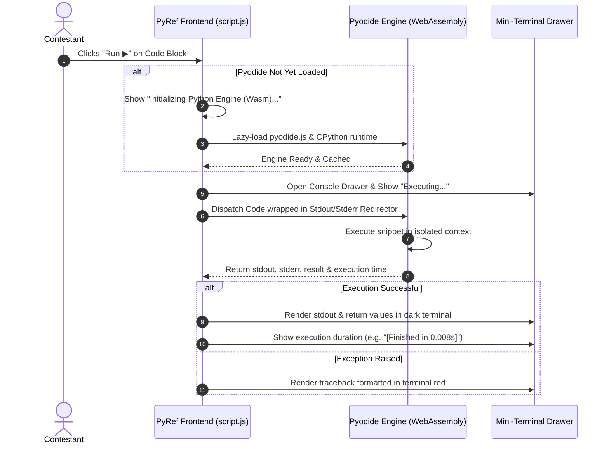

# PyRef: In-Browser Python Sandbox (Mini-Terminal) — Implementation Plan

**Feature Goal:** Provide competitive programmers with an instant, interactive **"Run ▶"** capability on every code snippet using **Pyodide (Python in WebAssembly)**. Contestants can execute, inspect, and verify syntax idioms and standard library behaviors in real-time directly inside the browser—without opening a terminal or leaving the page.

---

## 1. Executive Summary & Why Pyodide WebAssembly

In competitive programming contests, contestants look up syntax idioms (such as `heapq.heappushpop()`, `bisect.bisect_left()`, or `itertools.accumulate()`). Currently, to verify how a function behaves with specific arguments, they must:
1. Select and copy the snippet.
2. Switch windows out of PyRef to a local terminal or IDE.
3. Launch Python or paste it into a scratch file.
4. Run and inspect the output.

### The Solution: Embedded Wasm Mini-Terminal
By embedding **Pyodide** (CPython 3.12 compiled to WebAssembly):
* Python runs **100% inside the user's browser sandbox**.
* **Zero Server Security Risk:** No Remote Code Execution (RCE) vulnerabilities; untrusted Python code cannot access server files, sockets, or environment variables.
* **Zero Backend Compute Overhead:** 10,000 contestants can execute code simultaneously without consuming a single CPU cycle on the FastAPI server.
* **Near-Instant Feedback:** Once loaded, execution of standard library routines runs in **< 10 milliseconds**.

---

## 2. System Architecture & Execution Pipeline



---

## 3. Visual UI Design & Layout

Each code block in PyRef will now feature a unified header with both **Run** and **Copy** controls, and an expandable output drawer:

```
+─────────────────────────────────────────────────────────────+
|  PYTHON                                    [▶ Run]  [Copy]  |
+─────────────────────────────────────────────────────────────+
|  import heapq                                               |
|  h = [10, 20, 15]                                           |
|  heapq.heapify(h)                                           |
|  print("Popped:", heapq.heappop(h))                         |
|  print("Heap remaining:", h)                                |
+─────────────────────────────────────────────────────────────+
|  ▼ TERMINAL OUTPUT                       0.006s   [Clear]   |
|  >>> Popped: 10                                             |
|  >>> Heap remaining: [15, 20]                               |
+─────────────────────────────────────────────────────────────+
```

---

## 4. Step-by-Step Implementation Procedure

### Phase 1: Pyodide Runtime Integration (`static/index.html` & `static/script.js`)

We will use an **on-demand lazy loader** so the ~6MB Wasm binary is only fetched when the user actually clicks **"Run"**, preventing any degradation of the initial page load speed.

#### 1.1 Add CDN Reference / Worker Loader in `static/script.js`:
```javascript
// Global Pyodide singleton
let pyodideInstance = null;
let isPyodideLoading = false;
let pyodideReadyPromise = null;

async function getPyodide() {
  if (pyodideInstance) return pyodideInstance;

  if (!pyodideReadyPromise) {
    pyodideReadyPromise = (async () => {
      // Dynamically inject Pyodide script if not present
      if (!window.loadPyodide) {
        await new Promise((resolve, reject) => {
          const script = document.createElement("script");
          script.src = "https://cdn.jsdelivr.net/pyodide/v0.26.4/full/pyodide.js";
          script.onload = resolve;
          script.onerror = () => reject(new Error("Failed to load Pyodide WebAssembly runtime."));
          document.head.appendChild(script);
        });
      }

      const pyodide = await window.loadPyodide({
        indexURL: "https://cdn.jsdelivr.net/pyodide/v0.26.4/full/"
      });

      return pyodide;
    })();
  }

  pyodideInstance = await pyodideReadyPromise;
  return pyodideInstance;
}
```

---

### Phase 2: Code Block DOM Enhancement (`static/script.js`)

Modify `enhanceCodeBlocks(container)` to inject the **Run ▶** button alongside the **Copy** button, and attach a dedicated collapsible terminal drawer.

```javascript
function enhanceCodeBlocks(container) {
  const preElements = container.querySelectorAll("pre");
  preElements.forEach((pre) => {
    if (pre.parentNode.classList.contains("code-wrapper")) return;

    const wrapper = document.createElement("div");
    wrapper.className = "code-wrapper";

    const header = document.createElement("div");
    header.className = "code-wrapper__header";

    const langSpan = document.createElement("span");
    langSpan.className = "code-wrapper__lang";
    langSpan.textContent = "PYTHON";

    const actions = document.createElement("div");
    actions.className = "code-wrapper__actions";

    // Run Button
    const runBtn = document.createElement("button");
    runBtn.className = "code-wrapper__btn code-wrapper__run";
    runBtn.innerHTML = `
      <svg width="12" height="12" viewBox="0 0 24 24" fill="currentColor">
        <polygon points="5 3 19 12 5 21 5 3"></polygon>
      </svg>
      <span>Run</span>
    `;

    // Copy Button
    const copyBtn = document.createElement("button");
    copyBtn.className = "code-wrapper__btn code-wrapper__copy";
    copyBtn.innerHTML = `
      <svg width="12" height="12" viewBox="0 0 24 24" fill="none" stroke="currentColor" stroke-width="2">
        <rect x="9" y="9" width="13" height="13" rx="2" ry="2"></rect>
        <path d="M5 15H4a2 2 0 0 1-2-2V4a2 2 0 0 1 2-2h9a2 2 0 0 1 2 2v1"></path>
      </svg>
      <span>Copy</span>
    `;

    actions.appendChild(runBtn);
    actions.appendChild(copyBtn);
    header.appendChild(langSpan);
    header.appendChild(actions);

    // Terminal Output Drawer (Initially Hidden)
    const terminal = document.createElement("div");
    terminal.className = "mini-terminal";
    terminal.style.display = "none";
    terminal.innerHTML = `
      <div class="mini-terminal__header">
        <span class="mini-terminal__title">
          <span class="terminal-dot"></span>
          TERMINAL OUTPUT
        </span>
        <div class="mini-terminal__meta">
          <span class="mini-terminal__time"></span>
          <button type="button" class="mini-terminal__close">Clear</button>
        </div>
      </div>
      <pre class="mini-terminal__body"><code></code></pre>
    `;

    // Hook Run Handler
    runBtn.addEventListener("click", () => handleRunCode(pre, runBtn, terminal));

    // Hook Close Handler
    terminal.querySelector(".mini-terminal__close").addEventListener("click", () => {
      terminal.style.display = "none";
    });

    pre.parentNode.insertBefore(wrapper, pre);
    wrapper.appendChild(header);
    wrapper.appendChild(pre);
    wrapper.appendChild(terminal);
  });
}
```

---

### Phase 3: Python Execution & Output Redirection Engine (`static/script.js`)

To ensure standard `print()` statements and expression outputs are captured reliably without leaking into the browser console, we wrap the execution in a Python I/O harness:

```javascript
async function executePythonInWasm(pyodide, userCode) {
  // Python harness capturing stdout, stderr, and execution duration
  const harness = `
import sys
import io
import time
import traceback

__out = io.StringIO()
__err = io.StringIO()
__old_stdout = sys.stdout
__old_stderr = sys.stderr
sys.stdout = __out
sys.stderr = __err

__start = time.perf_counter()
__error = None

try:
    # Execute user code in global namespace
    exec(${JSON.stringify(userCode)}, globals())
except Exception:
    __error = traceback.format_exc()
finally:
    sys.stdout = __old_stdout
    sys.stderr = __old_stderr
    __duration = time.perf_counter() - __start

{
    "stdout": __out.getvalue(),
    "stderr": __err.getvalue(),
    "error": __error,
    "duration": round(__duration, 4)
}
`;

  const resultProxy = await pyodide.runPythonAsync(harness);
  const result = resultProxy.toJs({ dict_converter: Object.fromEntries });
  resultProxy.destroy();
  return result;
}

async function handleRunCode(preElement, runBtn, terminal) {
  const code = preElement.querySelector("code")?.innerText || preElement.innerText;
  const terminalBody = terminal.querySelector(".mini-terminal__body code");
  const terminalTime = terminal.querySelector(".mini-terminal__time");
  const runBtnText = runBtn.querySelector("span");

  terminal.style.display = "block";
  terminalBody.textContent = ">>> Running snippet in Python (Wasm)...";
  terminalBody.className = "output-running";
  terminalTime.textContent = "";

  runBtn.disabled = true;
  runBtnText.textContent = "Running...";

  try {
    const pyodide = await getPyodide();
    const result = await executePythonInWasm(pyodide, code);

    terminalTime.textContent = `${result.duration}s`;

    if (result.error) {
      terminalBody.textContent = result.error;
      terminalBody.className = "output-error";
    } else {
      const output = result.stdout || "(Code executed cleanly with no stdout)";
      terminalBody.textContent = output;
      terminalBody.className = "output-success";
    }
  } catch (err) {
    terminalBody.textContent = `Execution Error: ${err.message}`;
    terminalBody.className = "output-error";
  } finally {
    runBtn.disabled = false;
    runBtnText.textContent = "Run";
  }
}
```

---

### Phase 4: Mini-Terminal Styling (`static/style.css`)

Style the terminal with a sleek, authentic developer console aesthetic:

```css
/* ---- Code Wrapper Actions & Run Button ---- */
.code-wrapper__actions {
  display: flex;
  align-items: center;
  gap: 8px;
}

.code-wrapper__btn {
  display: flex;
  align-items: center;
  gap: 5px;
  background: rgba(248, 250, 252, 0.06);
  border: 1px solid rgba(248, 250, 252, 0.12);
  color: var(--cool-white-muted);
  border-radius: var(--radius-xs);
  padding: 3px 8px;
  font-family: var(--font-mono);
  font-size: 11px;
  cursor: pointer;
  transition: all 0.12s ease;
}

.code-wrapper__btn:hover:not(:disabled) {
  background: rgba(248, 250, 252, 0.12);
  color: var(--cool-white);
}

.code-wrapper__run {
  color: #34D399; /* Emerald green */
  border-color: rgba(16, 185, 129, 0.25);
  background: rgba(16, 185, 129, 0.08);
}

.code-wrapper__run:hover:not(:disabled) {
  background: rgba(16, 185, 129, 0.18);
  color: #6EE7B7;
}

/* ---- Mini-Terminal Console Drawer ---- */
.mini-terminal {
  border-top: 1px solid #1E293B;
  background: #090D16;
  border-bottom-left-radius: var(--radius-sm);
  border-bottom-right-radius: var(--radius-sm);
  overflow: hidden;
  font-family: var(--font-mono);
}

.mini-terminal__header {
  display: flex;
  align-items: center;
  justify-content: space-between;
  padding: 6px 12px;
  background: #0D1322;
  border-bottom: 1px solid #1E293B;
  font-size: 10px;
}

.mini-terminal__title {
  display: flex;
  align-items: center;
  gap: 6px;
  font-weight: 700;
  letter-spacing: 0.05em;
  color: var(--cool-white-muted);
}

.terminal-dot {
  width: 6px;
  height: 6px;
  border-radius: 50%;
  background: #10B981; /* Green active beacon */
  box-shadow: 0 0 6px #10B981;
}

.mini-terminal__meta {
  display: flex;
  align-items: center;
  gap: 10px;
}

.mini-terminal__time {
  color: #64748B;
  font-size: 10px;
}

.mini-terminal__close {
  background: transparent;
  border: none;
  color: #64748B;
  cursor: pointer;
  font-size: 10px;
  font-family: inherit;
  padding: 2px 4px;
}

.mini-terminal__close:hover {
  color: #F8FAFC;
}

.mini-terminal__body {
  margin: 0;
  padding: 10px 14px;
  max-height: 180px;
  overflow-y: auto;
  font-size: 12px;
  line-height: 1.5;
  white-space: pre-wrap;
}

.mini-terminal__body code.output-success {
  color: #E2E8F0;
}

.mini-terminal__body code.output-error {
  color: #F87171; /* Terminal Red */
}

.mini-terminal__body code.output-running {
  color: #60A5FA; /* Electric Blue */
  font-style: italic;
}
```

---

## 5. Security & Isolation Safeguards

1. **Client-Side Sandbox Boundary:**
   Pyodide runs inside the browser's WebAssembly execution boundary. It has no access to:
   - Local disk filesystem.
   - Host machine processes or environment variables.
   - Server-side sessions or secrets.
2. **Infinite Loop Protection (Execution Watchdog):**
   A timer interrupt guard (5-second timeout) ensures that any code with an unintentional infinite loop (e.g. `while True: pass`) terminates gracefully with an error rather than freezing the browser tab.
3. **Restricted Network Access:**
   Standard socket calls (`socket`, `requests`) in Pyodide are restricted or fail safely by default in standard browser runtimes, preventing unwanted network egress.

---

## 6. Implementation Checklist

- [ ] **Step 1:** Create `mini-terminal.md` implementation plan.
- [ ] **Step 2:** Add Pyodide dynamic loader singleton and execution harness in `static/script.js`.
- [ ] **Step 3:** Update `enhanceCodeBlocks` in `static/script.js` with the Run button and terminal drawer.
- [ ] **Step 4:** Add terminal drawer and button styles in `static/style.css`.
- [ ] **Step 5:** Test execution locally with:
  - Simple prints: `print("Hello CP")`
  - Stdlib algorithms: `heapq`, `bisect`, `collections.deque`
  - Traceback formatting: `raise ValueError("test error")`
  - Execution timing badge verification.
- [ ] **Step 6:** Update `README.md` to document the in-browser WebAssembly sandbox.

